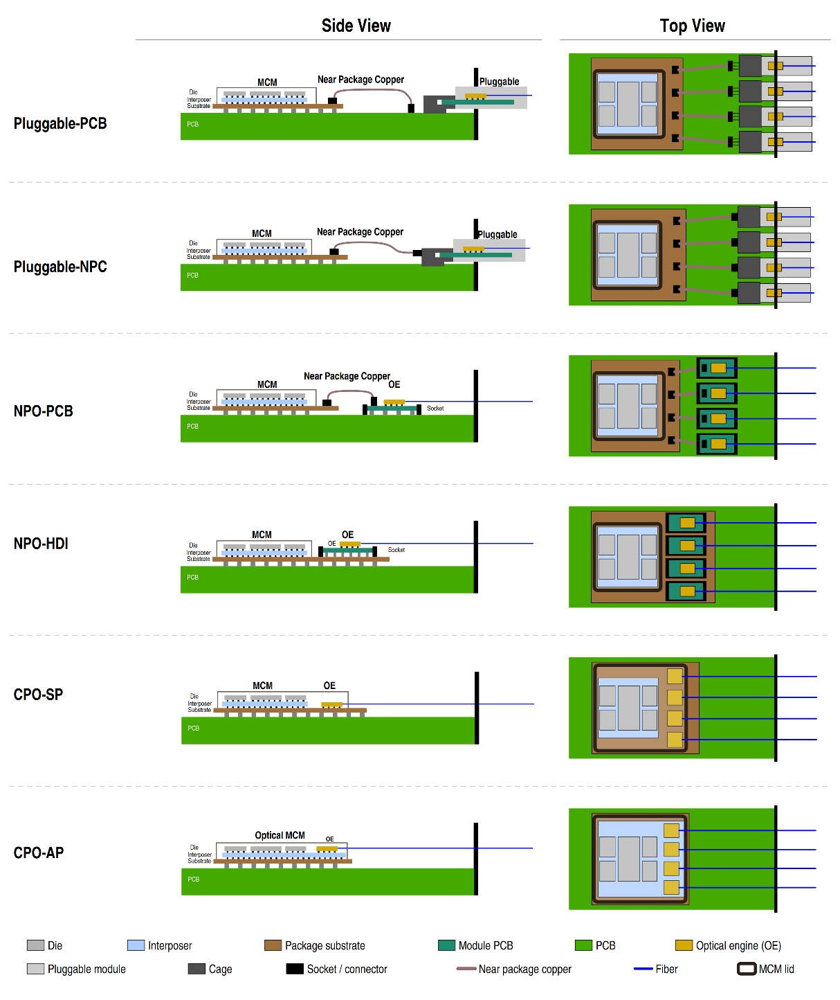

<!-- Generated from data/contribution.json and data/optical-options.json by scripts/build.py. -->

# Optical Connectivity Options

Workstream draft 0.5.5 · October 22, 2026

Jeff Hutchins, Ranovus

## Introduction

As data rates climb toward 200G per lane and beyond, the industry is exploring several ways to bring optics closer to the host ASIC, and the terminology used to describe these options is often inconsistent. The table below organizes them into three categories by location: Front Pluggable Optics (FPO) at the faceplate, Near Package Optics (NPO) on the PCB or HDI substrate, and Co-Packaged Optics (CPO) inside the package. It compares each option across attachment method, connection pitch, electrical interface, characteristics, interoperability, and standards maturity. In short, moving optics closer to the ASIC shortens the electrical path, reducing loss and increasing bandwidth density, but at the cost of replaceability and with less mature standards.

## Optical Connectivity Options

*Table 1 – Connectivity Options and Characteristics*

| Criterion | FPO | NPO-PCB [1] | NPO-HDI [2] | CPO | CPO-AP [3] |
| --- | --- | --- | --- | --- | --- |
| Location | Optics At Front Panel | Optics Behind the Front Panel | Optics Behind the Front Panel | Optics Behind the Front Panel | Optics Behind the Front Panel |
| Family | Front Pluggable Optics | Near Package Optics | Near Package Optics | Co-Packaged Optics | Co-Packaged Optics |
| Name | Optics Plugged at Front Panel | (or OBO) Optics on PCB | Optics on HDI | Optics with Standard Packaging | Optics with Advanced Packaging |
| Attachment | Receptacle on front panel | Socketed or Soldered On PCB | Socketed or Soldered On HDI | Soldered (Standard Packaging) | Soldered (Advanced Packaging) |
| Rough Pitch for High-speed | ~0.5 - 1.0 mm | PCB: 0.6-1.0 mm | HDI: 0.3-0.5 mm | C4 bumps / ~ 110 µm | µbumps / ~ 30-50 µm |
| Electrical I/F for High-speed | High-speed &gt; 22 dB / 200G | High-speed Flex/Cable: 13-18dB/200G PCB: 16-22 dB / 200G | High-speed HDI: 13-18dB/200G | High-speed, &amp; D2D (e.g. UCIe-S, BoW) | High-speed, &amp; D2D (e.g. UCIe-A, BoW) |
| Characteristics | • May use integrated copper attach, copper/flex, or PCB traces | • May use integrated copper attach, copper/flex, or PCB traces | • HDI traces | • Lowest loss • High BW edge density • Integrated SoC | • Lowest loss • Highest BW edge density • Highly integrated SoC |
| Interoperability &amp; Binding | Replaceable with interoperable optics at any time in life cycle, generally hot swappable | • Soldered: Interoperable but not replaceable • Socketed: Replaceable when removing blade | • Soldered: Interoperable but not replaceable • Socketed: Replaceable when removing blade | • Interoperable at chiplet level but not replaceable | • Interoperable at chiplet level but not replaceable |
| Standards | Standardized | Standards being developed | Standards being developed | Some standards exist, others remain to be developed | Some standards exist, others remain to be developed |

### Terminology notes

1. NPO-PCB implementations are sometimes referred to as On-Board Optics (OBO)
2. Some on-package implementations of NPO-HDI are sometimes referred to as "CPO" (CPO-HDI)
3. A specific implementation of CPO-AP using a combination of an interposer and µbumps for optics has been referred to as Co-Integrated Optics (CIO)

## Illustrations

*Figure 1 - O/E Placement Options side view and top view*

[Editable side-view SVG](docs/assets/naming-drawings.svg)

## License

### Creative Commons

OCP encourages participants to share their proposals, specifications and designs with the community. This is to promote openness and encourage continuous and open feedback. It is important to remember that by providing feedback for any such documents, whether in written or verbal form, that the contributor or the contributor's organization grants OCP and its members irrevocable right to use this feedback for any purpose without any further obligation.

It is acknowledged that any such documentation and any ancillary materials that are provided to OCP in connection with this document, including without limitation any white papers, articles, photographs, studies, diagrams, contact information (together, “Materials”) are made available under the Creative Commons Attribution-ShareAlike 4.0 International License found here: https://creativecommons.org/licenses/by-sa/4.0/, or any later version, and without limiting the foregoing, OCP may make the Materials available under such terms.

As a contributor to this document, all members represent that they have the authority to grant the rights and licenses herein. They further represent and warrant that the Materials do not and will not violate the copyrights or misappropriate the trade secret rights of any third party, including without limitation rights in intellectual property. The contributor(s) also represent that, to the extent the Materials include materials protected by copyright or trade secret rights that are owned or created by any third-party, they have obtained permission for its use consistent with the foregoing. They will provide OCP evidence of such permission upon OCP’s request. This document and any "Materials" are published on the respective project's wiki page and are open to the public in accordance with OCP's Bylaws and IP Policy. This can be found at http://www.opencompute.org/participate/legal-documents/. If you have any questions, please contact OCP.

## About Open Compute Foundation

The Open Compute Project (OCP) brings at-scale innovations and hyperscaler best practices to all, spanning technology domains from the data center to the edge, and the technology stack from silicon, to systems, to site facilities and services. The international OCP Community is made up of organizations and people from hyperscale and tier-2 cloud data center operators, communications providers, colocation providers, diverse enterprises, and technology vendors. The OCP Foundation fosters collaboration within the Community to tackle market challenges in an array of OCP Projects that create open contributions such as specifications, designs, and more. The OCP Solution Provider Program then recognizes the application of those contributions in compliant products, solutions, and data center facilities and services with designations like OCP Inspired, OCP Accepted and OCP Ready. With the tenets of openness, impact, efficiency, scale and sustainability, the OCP engages and educates thousands of engineers every year through many events and webinars. Across many initiatives the OCP Foundation and Community are meeting the market today and shaping the future.

Learn more at: www.opencompute.org.
